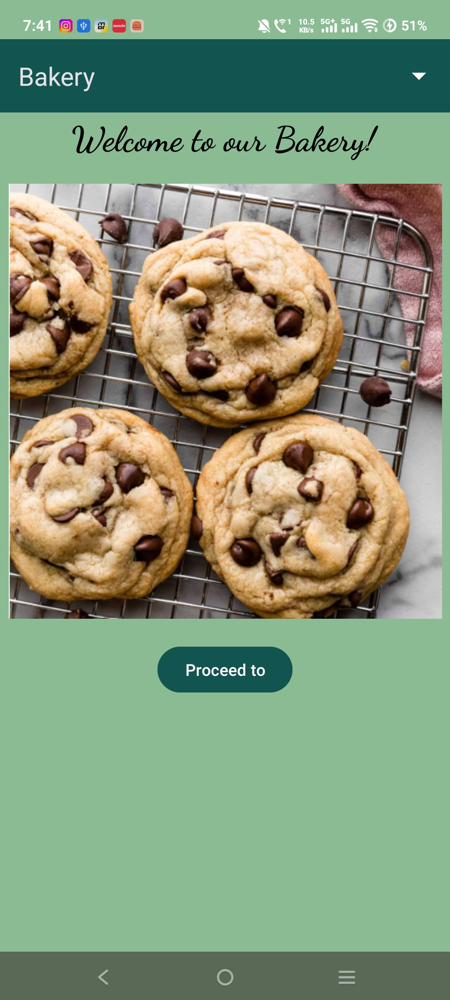
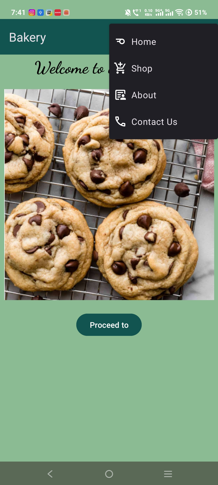
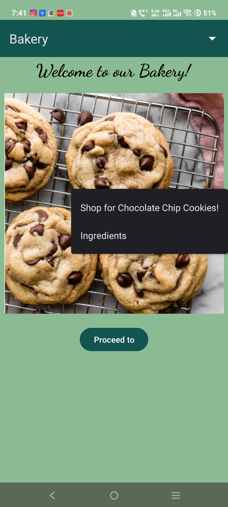
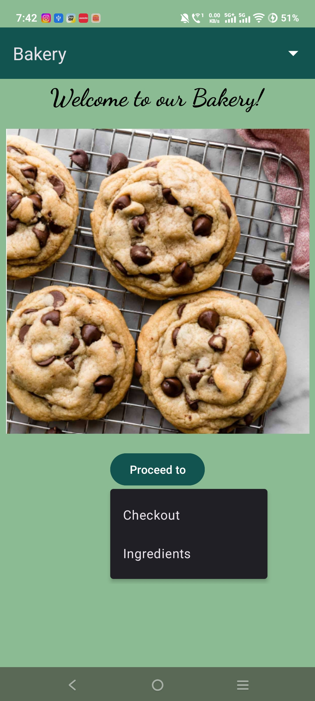

# Bakery Application

## Overview

The Bakery application is a simple Android application that welcomes
users to a bakery. The home screen displays a bakery heading, a
chocolate chip cookie image, and a **Proceed to** button. The
application demonstrates three Android menu types: an **Option Menu**, a
**Context Menu**, and a **Popup Menu**.

## Menus Used in the Application

### 1. Option Menu

An **Option Menu** provides the main navigation and actions for an
activity. It is commonly displayed in the app bar or toolbar, usually
through the menu icon at the top-right corner.

In this application, the Option Menu is opened using the drop-down arrow
in the top app bar. It contains:

-   **Home** -- navigates to the home screen.
-   **Shop** -- opens the shopping section.
-   **About** -- displays information about the bakery.
-   **Contact Us** -- provides the bakery's contact information.

**Purpose:** The Option Menu gives users access to the application's
main sections from one convenient location.

### 2. Context Menu

A **Context Menu** displays actions related to a particular view or
item. It is generally opened when the user touches and holds
(long-presses) that view.

In this application, the Context Menu is associated with the chocolate
chip cookie image. When the image is long-pressed, the menu displays:

-   **Shop for Chocolate Chip Cookies!** -- provides an action to shop
    for the displayed cookies.
-   **Ingredients** -- provides information about the ingredients used
    in the cookies.

**Purpose:** The Context Menu offers actions that are directly relevant
to the selected item, rather than showing general application
navigation.

### 3. Popup Menu

A **Popup Menu** displays a small list of actions anchored to a specific
view. It appears when the user taps the view associated with the menu
and disappears after an action is selected or the menu is dismissed.

In this application, the Popup Menu is associated with the **Proceed
to** button. Tapping the button displays:

-   **Checkout** -- takes the user to the checkout process.
-   **Ingredients** -- displays the cookie ingredients.

**Purpose:** The Popup Menu provides quick actions related to the button
without requiring the user to navigate to another menu or screen first.

## Difference Between the Three Menus

  -----------------------------------------------------------------------
  Menu              How it is opened  Main purpose      Used in this
                                                        application
  ----------------- ----------------- ----------------- -----------------
  Option Menu       Tap the menu      Main navigation   Home, Shop,
                    control in the    and general       About, Contact Us
                    app bar           actions           

  Context Menu      Long-press a      Actions related   Cookie image
                    specific view or  to the selected   actions
                    item              item              

  Popup Menu        Tap the view to   Quick actions     Proceed to button
                    which the menu is related to that   actions
                    anchored          view              
  -----------------------------------------------------------------------

## User Interface

The home screen includes:

-   A top app bar titled **Bakery**, with the Option Menu.
-   A welcome message: **Welcome to our Bakery!**
-   An image of chocolate chip cookies, associated with the Context
    Menu.
-   A **Proceed to** button, associated with the Popup Menu.

## Conclusion

This application demonstrates how Android menus can make an interface
easier to navigate and use. The Option Menu provides access to the main
sections, the Context Menu presents actions for a selected item, and the
Popup Menu displays quick actions associated with a particular view.
